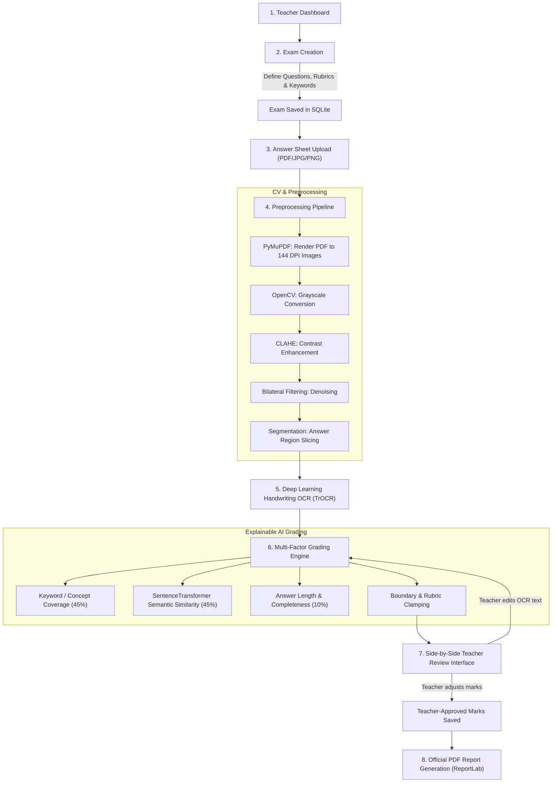

# Grade Script — Architecture & Workflow Summary

> **Project:** Grade Script — Deep Learning Handwritten Examination Evaluation Platform  
> **Status:** Backend & Frontend Active, Hardware Acceleration (CUDA 12.4 on RTX 3050 6GB) Verified  
> **Date:** October 11, 2026  

---

## 1. System Overview

Grade Script is a full-stack AI-assisted grading system designed to evaluate student handwritten examination papers. The application leverages:
1. **Microsoft TrOCR (`microsoft/trocr-base-handwritten`)** running on GPU (CUDA) for line-level handwriting recognition.
2. **Sentence Transformers (`all-MiniLM-L6-v2`)** for contextual semantic similarity comparison against reference answers.
3. **Keyword & Rubric Scoring Engine** providing explainable, transparent grading suggestions while keeping final grading authority under the teacher's control.

---

## 2. End-to-End Workflow



---

## 3. Detailed Component Breakdown

### A. Preprocessing & Computer Vision (`app/services/preprocessing/image_processor.py`)
- **PDF Page Extraction:** Uses `PyMuPDF` with a 2.0x zoom matrix to render crisp 144 DPI images suitable for handwriting analysis.
- **Image Enhancement:** Uses OpenCV with **CLAHE** (Contrast Limited Adaptive Histogram Equalization) and **Bilateral Filtering** to preserve sharp pen strokes while removing background scanner noise.
- **Bounding & Slicing:** Dynamically computes answer block regions and crops them into isolated answer crops saved in `uploads/crops/`.

### B. Deep Learning Handwriting Recognition (`app/services/handwriting/ocr_engine.py`)
- **Model:** Microsoft TrOCR (`microsoft/trocr-base-handwritten`), a Transformer-based Vision Encoder-Decoder.
- **Hardware Acceleration:** Native PyTorch 2.6 using CUDA on the laptop's NVIDIA RTX 3050 (6GB VRAM).
- **Blank Detection:** Analyzes crop standard deviation; if an answer box is empty, it tags the box as `[Blank or empty answer region]` to prevent hallucinations.
- **Editable Transcriptions:** The extracted text is presented to the teacher with full inline correction capabilities.

### C. Multi-Factor Grading Engine (`app/services/grading/engine.py`)
Grading is designed to be **explainable and balanced**:
1. **Essential Concept Extraction:** Verifies that required domain keywords (or key concepts extracted from the reference solution) are addressed in the student's writing.
2. **Semantic Similarity:** Computes vector cosine similarity between student phrasing and reference answer via `all-MiniLM-L6-v2`.
3. **Partial Credit:** Combines concept presence (45%), semantic meaning (45%), and answer completeness (10%).
4. **Teacher Review Flags:** If the semantic match is low or essential keywords are missing, the system flags the question with a `Review Needed` badge.

### D. Side-by-Side Teacher Review (`frontend/src/pages/EvaluationReview.tsx`)
- Displays the original handwritten crop directly beside the TrOCR-extracted transcription.
- Displays semantic similarity %, matched concepts, missing concepts, and the AI's grading rationale.
- Allows the teacher to modify the transcription (which automatically triggers re-evaluation) or directly override the awarded marks.
- Distinctly stores **AI-suggested marks** and **teacher-approved marks**.

### E. Official PDF Reporting (`app/services/reporting/pdf_generator.py`)
- Built with `ReportLab`.
- Exports a complete examination report containing student roll number, exam title, question breakdown, individual rationales, total score, percentage, and teacher signoff.

---

## 4. Current Repository Layout

```text
DLL FINAL/
├── backend/
│   ├── app/
│   │   ├── api/routes.py            # API endpoints: dashboard, exams, upload, review, report
│   │   ├── database/session.py      # SQLite connection & session maker
│   │   ├── models/entities.py       # SQLAlchemy schemas (Exam, Question, Submission, Region, etc.)
│   │   ├── schemas/schemas.py       # Pydantic request/response validation
│   │   ├── services/
│   │   │   ├── preprocessing/       # PyMuPDF rendering & OpenCV CLAHE enhancement
│   │   │   ├── handwriting/         # Microsoft TrOCR on PyTorch CUDA
│   │   │   ├── grading/             # Semantic similarity & concept matchers
│   │   └── main.py                  # FastAPI app entry with CORS & static file serving
│   ├── uploads/                     # Storage for documents, crops, and generated reports
│   └── requirements.txt
├── frontend/
│   ├── src/
│   │   ├── pages/
│   │   │   ├── Dashboard.tsx        # Analytics KPIs and recent exams/submissions
│   │   │   ├── CreateExam.tsx       # Exam and question creation form
│   │   │   ├── UploadSheet.tsx      # Answer sheet upload and preview
│   │   │   └── EvaluationReview.tsx # Side-by-side review, OCR editing, mark override
│   │   ├── services/api.ts          # Axios client with proxy endpoints
│   │   ├── types/index.ts           # Shared TypeScript interfaces
│   │   ├── App.tsx                  # Navigation & layout
│   │   └── index.css                # Tailwind CSS v4 styling
│   ├── vite.config.ts               # Vite configuration with proxy to port 8000
│   └── package.json
└── docs/
    ├── BUILD_STATUS.md              # Technical log and verification results
    └── WORKFLOW_SUMMARY.md          # Architecture and operational workflow document
```

---

## 5. Live Environment Status

- **Backend:** `http://127.0.0.1:8000` (Uvicorn / FastAPI) — **Active**
- **Frontend:** `http://127.0.0.1:5173` (Vite / React) — **Active**
- **Database:** SQLite (`gradescript.db`) initialized with all tables.
- **GPU Inference:** PyTorch 2.6 + CUDA 12.4 on NVIDIA GeForce RTX 3050 6GB.
