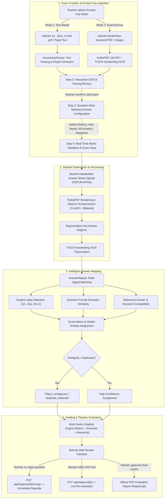

# Grade Script — Architecture & Workflow Summary

> **Project:** Grade Script — Deep Learning Handwritten Examination Evaluation Platform  
> **Status:** Backend & Frontend Active, Hardware Acceleration (CUDA 12.4 on RTX 3050 6GB) Verified  
> **Milestone Completed:** Answer Key OCR, Marking Scheme Configuration & Intelligent Answer Mapping  
> **Date:** October 28, 2026  

---

## 1. System Overview

Grade Script is an end-to-end AI-assisted exam grading system designed for educators. It combines deep learning computer vision, handwritten OCR, and explainable NLP grading:
1. **Microsoft TrOCR (`microsoft/trocr-base-handwritten`)** running on GPU (CUDA) for line-level handwriting recognition on answer keys and student submissions.
2. **Sentence Transformers (`all-MiniLM-L6-v2`)** for vector cosine similarity evaluation against reference answers, alternative acceptable solutions, and rubric criteria.
3. **Structured Question-Wise Rubrics & Marking Schemes** allowing itemized point criteria, partial-credit rules, alternative answers, and optional negative marking.
4. **Intelligent Answer Mapping Engine** that maps student answer regions to reference questions regardless of order (e.g. Q3 answered before Q1), multi-signal candidate scoring, ambiguity detection, and instant remapping with live regrading.
5. **Teacher Control & Explainability**: The teacher retains final authority, with inline handwriting transcription editing, question remapping dropdowns, mark adjustments, and PDF report generation.

---

## 2. End-to-End Workflow Diagram



---

## 3. Core Features & Service Architecture

### A. Two Answer Key Ingestion Modes (`app/services/answer_key/parser.py`)
- **Mode 1 (Text-Based):**
  - Accepts direct text input or file uploads (`.txt`, `.docx`, `.pdf`).
  - Extracts text natively with PyMuPDF and `python-docx` (with zip/XML fallback).
  - Uses regex patterns to identify question labels (`Q1`, `1(a)`), statements, reference answers, embedded marks (`[Max Marks: 5]`), and rubric points.
  - Preserves any unparsed text in an `unparsed_content` buffer so nothing is lost.
- **Mode 2 (Scanned Handwritten Key):**
  - Accepts scanned multi-page PDFs or image files.
  - Converts PDF pages into 144 DPI images via PyMuPDF.
  - Preprocesses each page and runs Microsoft TrOCR to transcribe handwritten questions and solutions.
  - Reconstructs questions, subquestions, and answers with source page numbers.
  - Presents extracted items in an editable review interface before finalizing.

### B. Question-Wise Marking Scheme Configuration
- Each question supports:
  - **`question_label`**: Custom identifiers (`1(a)`, `Q2.1`, `Section B Q3`).
  - **`max_marks`**: Maximum points allocated to the question.
  - **`rubric_criteria`**: Structured list of criteria items with itemized marks:
    ```json
    [
      {"criterion": "Accurate definition of overfitting", "marks": 2.0},
      {"criterion": "Mention of training noise/memorization", "marks": 2.0},
      {"criterion": "Consequence of poor generalization", "marks": 1.0}
    ]
    ```
  - **`partial_credit_rules`**: Natural-language guidelines for partial credit.
  - **`alternative_answers`**: List of alternative acceptable phrasing/solutions.
  - **`negative_marking`**: Optional penalty for incorrect or blank answers.
- **Validation**: Exam creation verifies that the sum of rubric item marks equals question `max_marks`, question labels are unique, and total exam marks equal the sum of questions.

### C. Intelligent Student Answer Mapping (`app/services/mapping/answer_mapper.py`)
- **Order-Independent Mapping**: Evaluates each student answer block against all exam questions. Even if a student answers Q3 first, followed by Q1 and Q2, the mapper correctly assigns each block.
- **Multi-Signal Score Matrix**:
  1. *Explicit Identifier Match*: Detects labels such as `Q1`, `1(a)`, `Ans 2:` with priority weighting (`0.85+` score).
  2. *Prompt Semantic Alignment*: Sentence transformer similarity between student answer opening lines and question text.
  3. *Reference Compatibility & Keyword Overlap*: Semantic similarity and domain keyword overlap against reference answers and acceptable alternatives.
- **Ambiguity & Duplicate Detection**:
  - If a student answers the same question twice, both are flagged with `duplicate_detected` for teacher review.
  - If the top two candidate questions have scores within `0.10` of each other and confidence `< 0.70`, the match is marked `is_ambiguous`.
- **Unanswered Reference Questions**: Detects reference questions that have no matching student answer and flags them in the review dashboard.
- **Interactive Remapping with Immediate Regrading**:
  - API endpoint: `PUT /api/regions/{region_id}/remap?question_id={new_question_id}`
  - Updates the question association, immediately re-evaluates using the newly assigned question's rubrics, alternative answers, and keywords, and recalculates the submission total.

### D. Multi-Factor Grading Engine (`app/services/grading/engine.py`)
- **Itemized Rubric Scoring**: If structured rubric criteria are configured, each criterion is evaluated independently against student text using semantic similarity and keyword coverage.
- **Alternative Solutions**: Compares student text against primary reference answer and all alternative answers, selecting the highest scoring alignment.
- **Negative Marking**: Applies configured penalties if answer is completely irrelevant.
- **Blank / Unreadable Detection**: Accurately recognizes empty answer regions or low-confidence handwriting and sets suggested marks to 0.0 with a review flag.

### E. Frontend Implementation
- **`CreateExam.tsx`**: 4-step wizard with visual mode toggle, drag-and-drop file upload, live OCR editing, interactive rubric builder tables, and total mark validation summary.
- **`EvaluationReview.tsx`**:
  - Intelligent Mapping banner with confidence score and method badge (`Explicit Label`, `Semantic`, `Duplicate Detected`).
  - Candidate match drawer showing alternative question candidates and similarity scores.
  - Live Question Remapping select dropdown with instant regrading.
  - Itemized Rubric breakdown table showing max vs. awarded marks per criterion.
  - Unanswered questions alert cards.
  - Teacher mark override and inline transcription editor.

---

## 4. Verification & Automated Tests

Run tests in `backend/`:
```bash
python -m pytest tests -v
```

**Results:** 15 passed, 0 failed (100% green).
- `test_answer_key_parser.py`: 3 tests (text parsing, subquestions, unparsed text preservation).
- `test_api_integration.py`: 4 tests (parsing API, rubric validation, duplicate label rejection, dashboard).
- `test_intelligent_mapping.py`: 4 tests (identifier regex, reordered answers, semantic mapping, duplicate/ambiguity detection).
- `test_marking_scheme_and_grading.py`: 4 tests (rubric-based evaluation, alternative answers, blank answers, negative marking).
